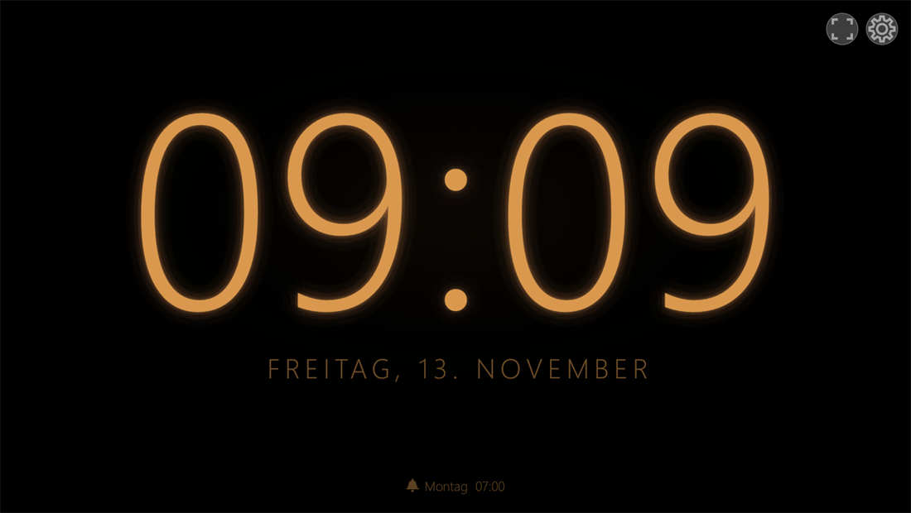
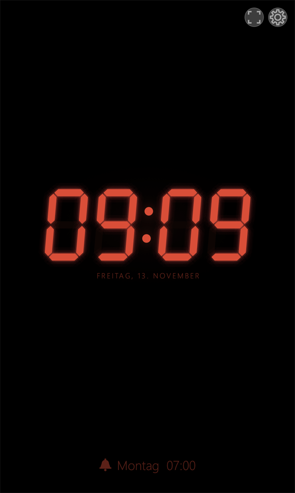
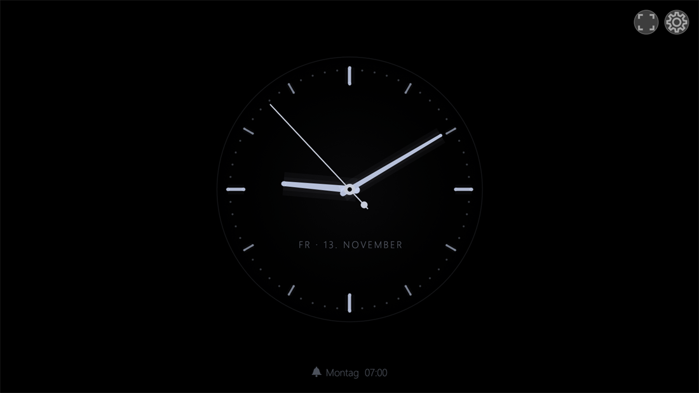
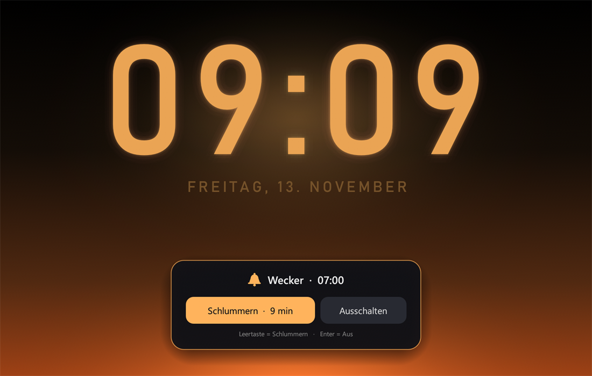

# NightClock

**Deutsch** · [English](#english)

Eine elegante Nachtuhr mit Wecker für Windows, gedacht für den Zweitbildschirm im Vollbild.
Geschrieben in Rust mit [egui](https://github.com/emilk/egui).



| 7-Segment im Hochformat | Analog | Wecker mit Lichtwecker |
|---|---|---|
|  |  |  |

## Funktionen

- **Drei Stile:** Schrift (jede installierte Schriftart), 7-Segment (LED-Wecker) und Analog
- **Vektor-Ziffern:** gestochen scharf in jeder Größe, auch auf 4K
- **Einzeilig oder zweizeilig:** Stunden und Minuten nebeneinander oder übereinander, ideal für Hochformat-Monitore
- **Helligkeit, Farbe, Leuchten, Größe, Hintergrund** und Schriftstärke bei variablen Schriften
- **Nachtmodus:** dimmt in einem Zeitfenster automatisch
- **Wecker:** mehrere Weckzeiten mit Wochentagen, drei eingebaute Töne oder eigene Audiodatei,
  sanft lauter werden, Schlummern, automatisches Ausschalten
- **Lichtwecker:** Vor dem Wecken wird der Bildschirm langsam warm und hell
- **Vollbild auf dem gewünschten Bildschirm**, Bildschirm wach halten, Einbrennschutz,
  Mauszeiger ausblenden, immer im Vordergrund
- **Deutsch und Englisch**, umschaltbar oben im Einstellungsmenü


## Bedienung

`NightClock.exe` starten. Mit `NightClock.exe --fullscreen` startet die Uhr direkt im Vollbild.

| Taste | Funktion |
|---|---|
| F11 · F · Doppelklick | Vollbild an / aus |
| Esc | Vollbild bzw. Menü schließen |
| S · Rechtsklick | Einstellungen |
| Mausrad · ↑ ↓ | Helligkeit |
| M | Nächster Bildschirm |
| 1 · 2 · 3 | Stil wechseln |
| Z | Einzeilig / zweizeilig |
| Leertaste | Schlummern |
| Enter | Wecker ausschalten |

Die Einstellungen werden automatisch in `%APPDATA%\NightClock\settings.json` gespeichert.

**Hinweis:** Der Wecker klingelt nur, solange NightClock läuft. Solange ein Wecker aktiv ist,
verhindert die App, dass Windows in den Ruhezustand geht.

## Selbst bauen

Voraussetzung: [Rust](https://rustup.rs) mit dem MSVC-Toolchain.

```
cargo build --release
```

Die fertige Datei liegt dann unter `target\release\nightclock.exe`.

---

<a name="english"></a>

# NightClock (English)

An elegant night clock with alarm for Windows, made to run fullscreen on a second monitor.
Written in Rust with [egui](https://github.com/emilk/egui).

## Features

- **Three styles:** text (any installed font), 7-segment (LED alarm clock) and analog
- **Vector digits:** razor-sharp at any size, including 4K
- **Single or two lines:** hours and minutes side by side or stacked, ideal for portrait monitors
- **Brightness, color, glow, size, background**, and font weight for variable fonts
- **Night mode:** dims automatically during a time window
- **Alarms:** several alarm times with weekdays, three built-in sounds or your own audio file,
  gentle fade-in, snooze, automatic shut-off
- **Wake-up light:** before the alarm, the screen slowly turns warm and bright
- **Fullscreen on the display of your choice**, keep screen awake, burn-in protection,
  hide mouse cursor, always on top
- **German and English**, switchable at the top of the settings menu

## Usage

Start `NightClock.exe`. `NightClock.exe --fullscreen` starts directly in fullscreen.

| Key | Action |
|---|---|
| F11 · F · Double-click | Fullscreen on / off |
| Esc | Exit fullscreen / close menu |
| S · Right-click | Settings |
| Mouse wheel · ↑ ↓ | Brightness |
| M | Next display |
| 1 · 2 · 3 | Change style |
| Z | Single / two lines |
| Space | Snooze |
| Enter | Turn off alarm |

Settings are saved automatically to `%APPDATA%\NightClock\settings.json`.

**Note:** Alarms only ring while NightClock is running. While an alarm is active,
the app keeps Windows from going to sleep.

## Building

Requires [Rust](https://rustup.rs) with the MSVC toolchain.

```
cargo build --release
```

The executable is then located at `target\release\nightclock.exe`.
